# PRD: Prospect CSV import errors users can understand and fix

**Design of record:** [prototype](https://product-team-sh.github.io/prd-prospect-csv-import/prototype/), every state captured on [the canvas](https://product-team-sh.github.io/prd-prospect-csv-import/canvas/) · **Copy:** [COPY.md](COPY.md), rendered in [copy.html](https://product-team-sh.github.io/prd-prospect-csv-import/copy.html) · **Status:** Draft, design sign-off pending

Card: [Self-Understandable / Self-Diagnosable Error Message for PROSPECT CSV upload Module](https://app.basecamp.com/4378325/buckets/22269754/card_tables/cards/10153297291). Code read 6 Nov 2026 (Upload checks re-read 11 Nov): webui `f9425f2`, edge `23c74c8`, background-jobs `7d18274`.

---

## 1. Problem

- **Most prospects arrive this way.** 71.0% of prospects created in the 90 days to 8 Sep came from CSV import, from about 1,836 users a week (measured, PostHog `Prospects Added`, `method = csv`).
- **Nothing is checked before import, and the result is unreadable.** Every outcome ends in a green toast. The report is `email,failed_reason`: one line per email, no row number, none of the user's columns ([writer](https://github.com/saleshandy/saleshandy-background-jobs/blob/7d18274f935ac261db9fa538aa3afe3d72d6894c/src/contacts/services/contacts-import.service.ts#L6838)). Six different email defects all read "Invalid Email" (measured, 5 Sep).
- **Some failures leave no trace.** Blank-email rows, invalid phones, crashed batches and Do Not Contact matches produce no report line. 0 of 409,820 import events in 90 days recorded a failure, because the only event fires on success (measured, 8 Sep).

## 2. Why this approach

| Option | Verdict |
|---|---|
| Better strings in today's report | Rejected: still no row numbers or user columns, still nothing before commit |
| A grid of failed rows in the dialog (card's original ask) | Rejected: can't fit a 720px dialog at 40,000 rows; reasons fit in five lines at any size |
| **Check before commit, reasons on screen, the user's own rows back with a fix per row** | **Chosen** |

Not claimed: fewer tickets or failed imports. Neither has a baseline.

## 3. What we're building

1. Every row is checked before anything is imported; Review shows what Import will do and, separately, what needs the user.
2. Nothing fails silently: every row not fully imported is in a file of the user's own rows, filterable by error, with one fix per row.
3. The flow is instrumented from day 1.

**Invariant:** nothing is written until Import is pressed; no failure loses the user's file or mapping.

## 4. User stories

| ID | As a user importing prospects, I… |
|---|---|
| U1 | see before importing how many will be added, what happens to ones already in my list, and what needs fixing and why |
| U2 | download only the rows I must act on, in my own columns, filter by error, and upload the fixed file without mapping again |
| U3 | am told why a file is rejected, and how to fix it, without restarting |
| U4 | stay on Review with my file and mapping if Import fails or another import is running |
| U5 | can import what fits when my plan or credits are short |
| U6 | pick the sequence step on Review and see who won't be added, and who the step can't work, before importing |
| U7 | skip Map Fields when a file with the same columns comes back |
| U8 | (product team) can read failure rates and reasons from day 1 |

## 5. Surfaces

Exact copy for every state below: [COPY.md](COPY.md), same section numbers; every string rendered on its surface in [copy.html](https://product-team-sh.github.io/prd-prospect-csv-import/copy.html).

**5.1 Upload.** An accepted file shows as one line (name, rows, columns, Remove file) over its first 3 rows under the file's own headers, exactly as read, so the user sees the wrong file or a bad parse before mapping (Hitesh, 11 Nov). Values wider than a cell truncate, full value on hover; a table wider than the dialog scrolls sideways and the caption says so. A rejected file shows, centred in the drop zone, the file name, what is wrong and one sentence on the fix; the zone stays live for the fixed file (Hitesh, 11 Nov). Eleven kinds: Excel, other type or no extension, over 95 MB, over 100,000 rows, over 120 columns, no prospects, repeated column names, columns with no name, mixed separators, not UTF-8, unreadable. Messages carry only what the check knows: no row totals, header names or column positions. Next stays disabled; no toasts or "Oops!". The checks that today fail only after Import (mixed separators, leading empty line, upper-case `.CSV`) move here.

<table><tr><td valign="top" width="33%"><a href="canvas/shots/u01.png">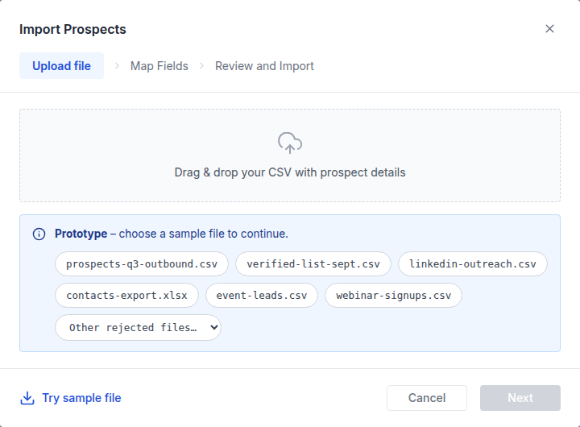</a> <b>Upload</b>. Drop zone; Try sample file in the footer</td><td valign="top" width="33%"><a href="canvas/shots/u02.png">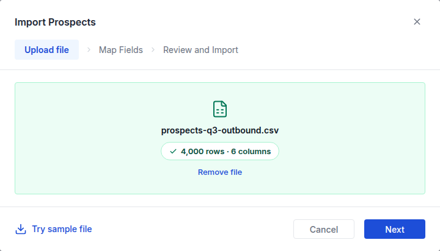</a> <b>File accepted</b>. One file line, then its first 3 rows as read; Next enabled</td><td valign="top" width="33%"><a href="canvas/shots/u03.png">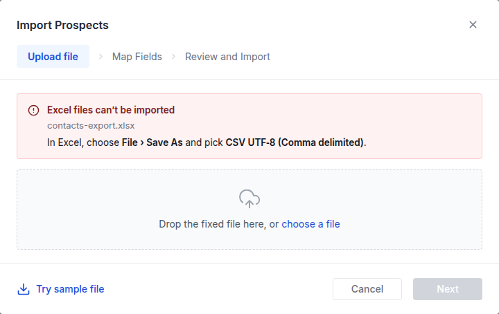</a> <b>Excel file</b>. Says only what the check knows; the drop zone stays live</td></tr><tr><td valign="top" width="33%"><a href="canvas/shots/u04.png">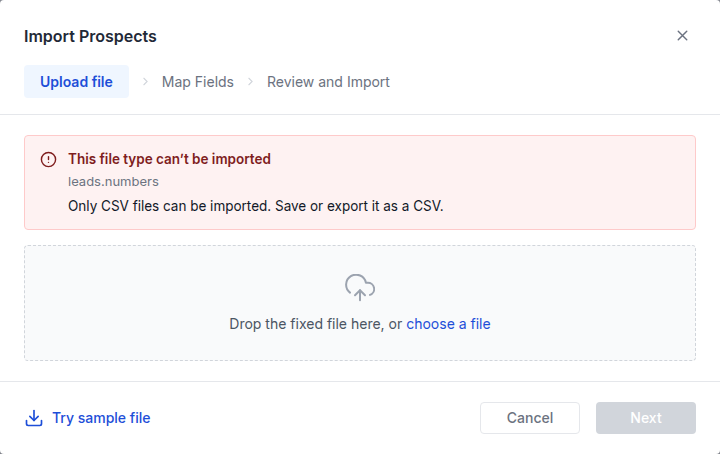</a> <b>Wrong file type</b>. Says only what the check knows; the drop zone stays live</td><td valign="top" width="33%"><a href="canvas/shots/u05.png">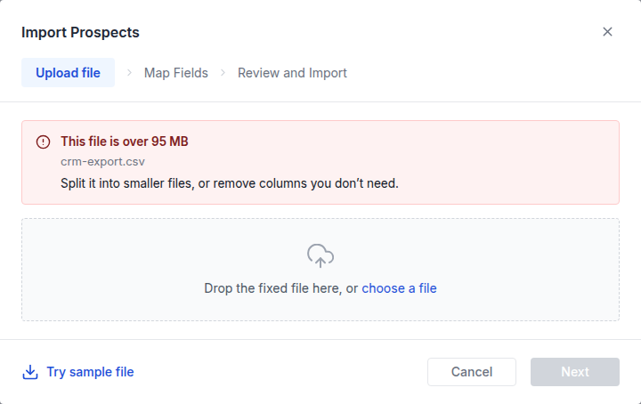</a> <b>Over 95 MB</b>. Says only what the check knows; the drop zone stays live</td><td valign="top" width="33%"><a href="canvas/shots/u06.png">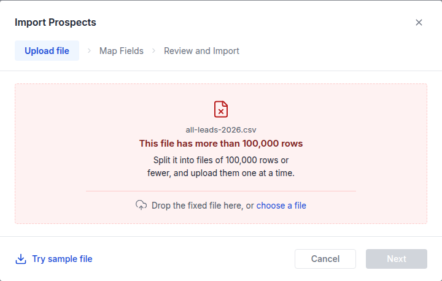</a> <b>Over 100,000 rows</b>. Says only what the check knows; the drop zone stays live</td></tr><tr><td valign="top" width="33%"><a href="canvas/shots/u07.png">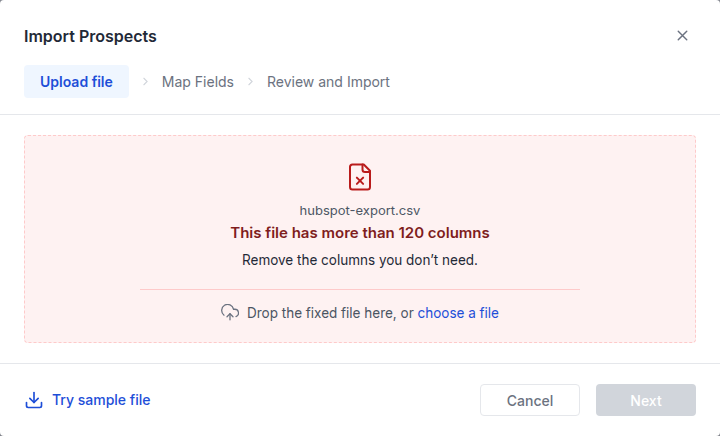</a> <b>Over 120 columns</b>. Says only what the check knows; the drop zone stays live</td><td valign="top" width="33%"><a href="canvas/shots/u08.png">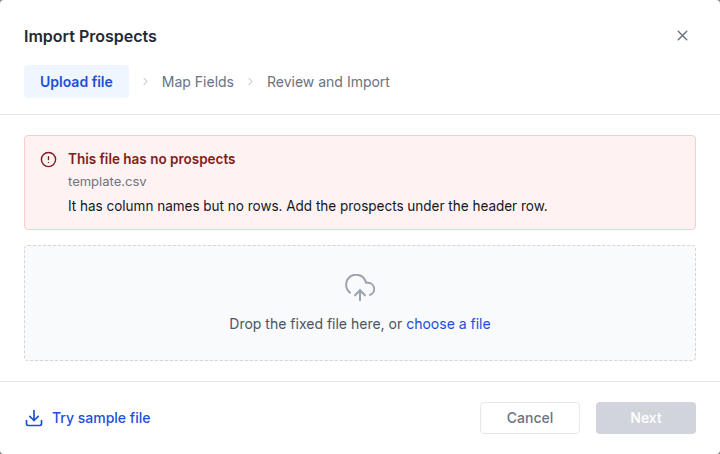</a> <b>No prospects</b>. Says only what the check knows; the drop zone stays live</td><td valign="top" width="33%"><a href="canvas/shots/u09.png">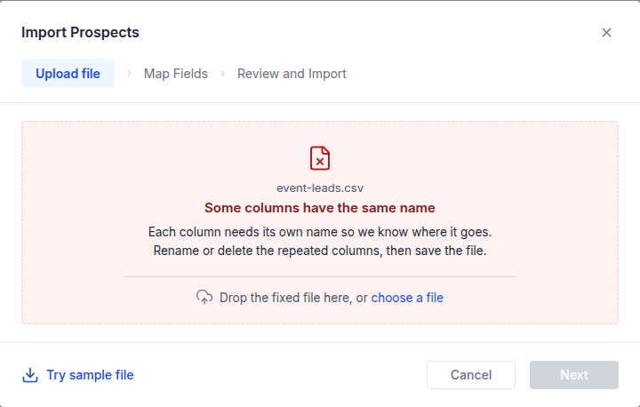</a> <b>Repeated column names</b>. Says only what the check knows; the drop zone stays live</td></tr><tr><td valign="top" width="33%"><a href="canvas/shots/u10.png">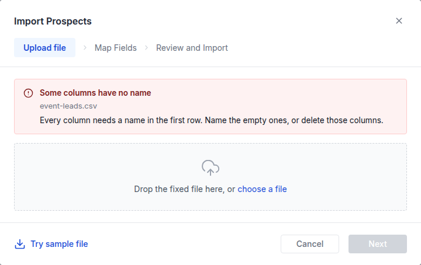</a> <b>Columns with no name</b>. Says only what the check knows; the drop zone stays live</td><td valign="top" width="33%"> <b>Mixed separators</b>. Says only what the check knows; the drop zone stays live</td><td valign="top" width="33%"><a href="canvas/shots/u12.png">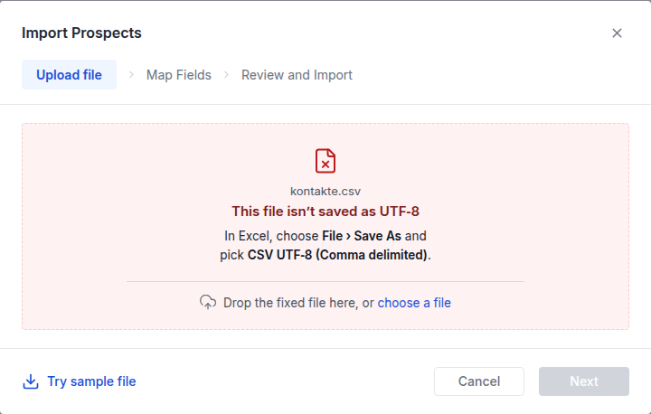</a> <b>Not UTF-8</b>. Says only what the check knows; the drop zone stays live</td></tr><tr><td valign="top" width="33%"><a href="canvas/shots/u13.png">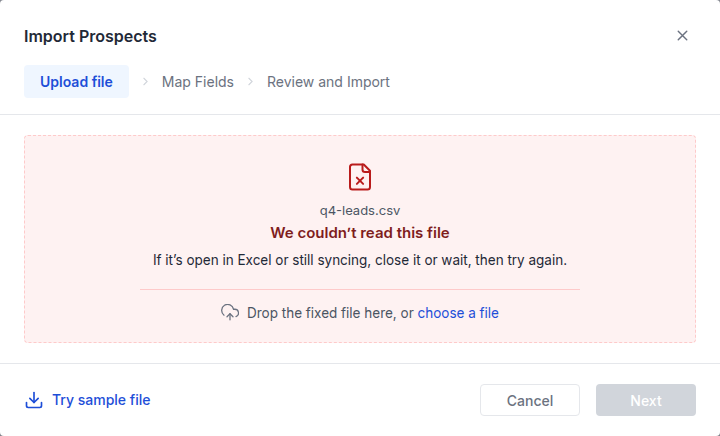</a> <b>Can’t be read</b>. Says only what the check knows; the drop zone stays live</td><td valign="top" width="33%"><a href="canvas/shots/u14.png">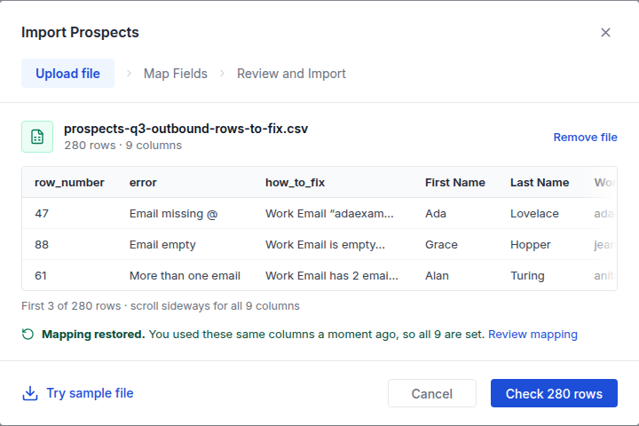</a> <b>Fixed file brought back</b>. Mapping restored; Check 280 rows skips Map Fields</td></tr></table>

**5.2 Map Fields.** Email required; if unmapped, say so and disable Next. After Import below the fields, production's four options verbatim. One column per field (picking a used field moves it and says so). Cancel, Esc or close keeps the mapping. The mapping is remembered by the set of headers, account-wide. Our three columns come back as Don't import.

<table><tr><td valign="top" width="33%"><a href="canvas/shots/m01.png">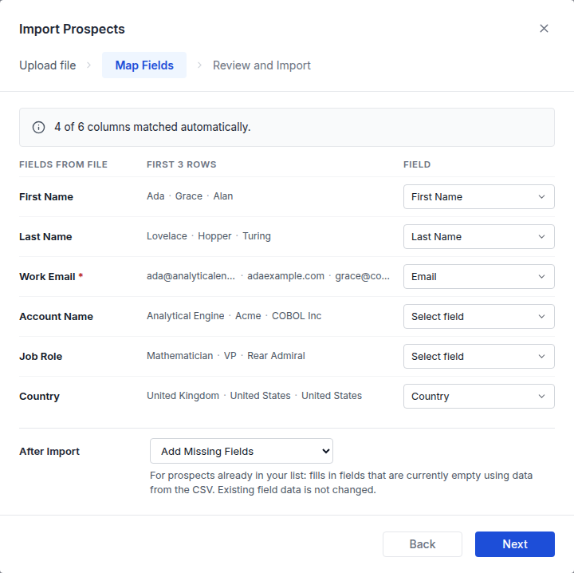</a> <b>Columns to set</b>. Two columns highlighted; After Import below</td><td valign="top" width="33%"><a href="canvas/shots/m02.png">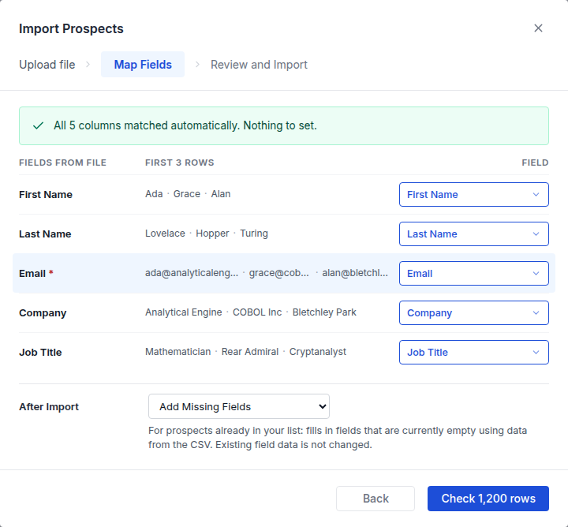</a> <b>Everything matched</b>. Nothing to set</td><td valign="top" width="33%"><a href="canvas/shots/m03.png">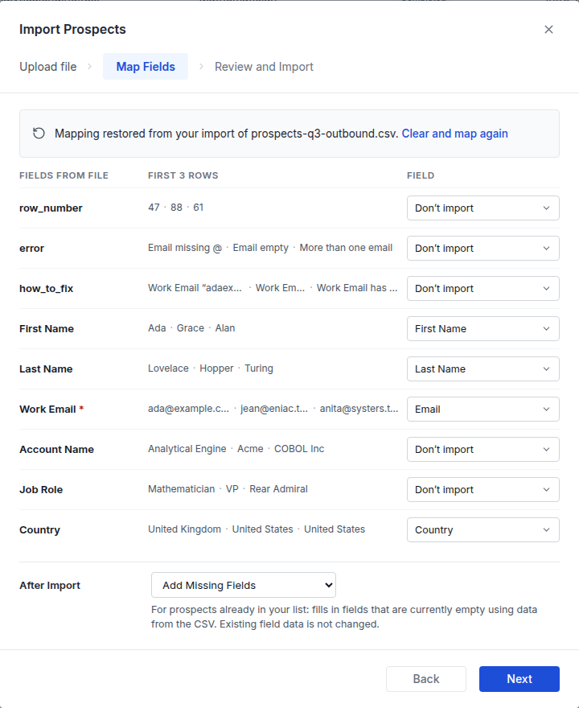</a> <b>Mapping restored</b>. Same columns as last time; our three columns set to Don’t import</td></tr><tr><td valign="top" width="33%"><a href="canvas/shots/m04.png">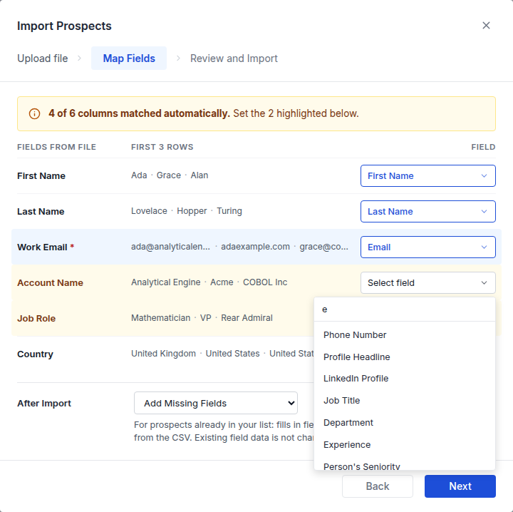</a> <b>Field picker</b>. Search, and fields already used by another column</td><td valign="top" width="33%"><a href="canvas/shots/m05.png">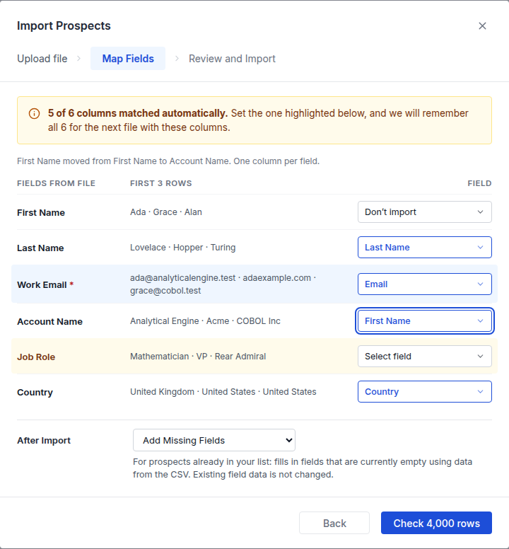</a> <b>A field moved</b>. One column per field: the earlier column is set aside, and the screen says so</td><td valign="top" width="33%"><a href="canvas/shots/m06.png">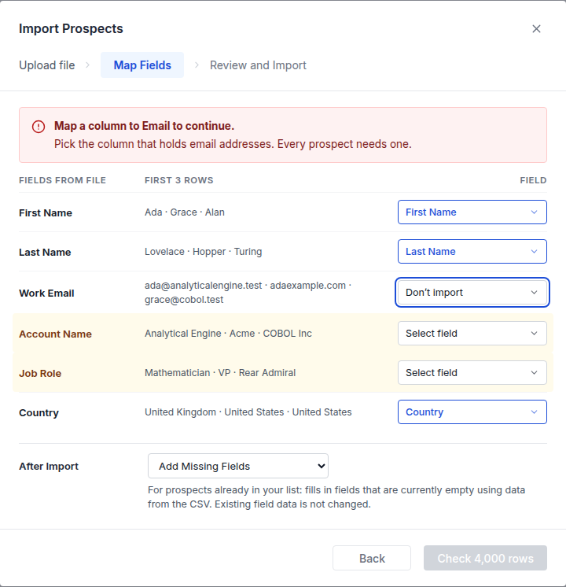</a> <b>Email not mapped</b>. Next disabled until a column is set to Email</td></tr><tr><td valign="top" width="33%"><a href="canvas/shots/m07.png">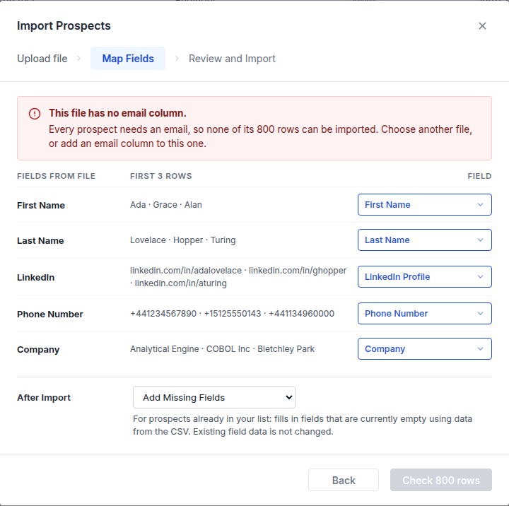</a> <b>No email column</b>. Said plainly; Next disabled</td><td valign="top" width="33%"><a href="canvas/shots/m08.png">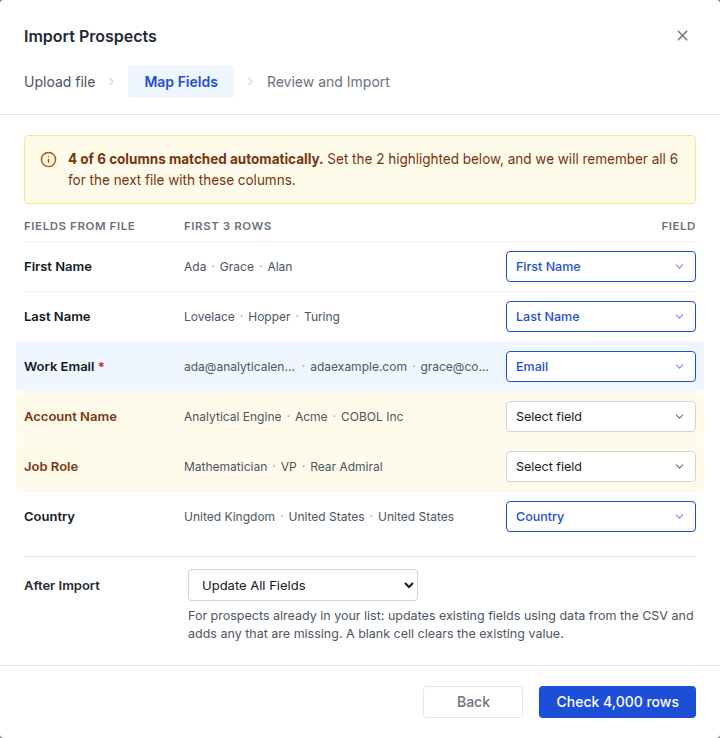</a> <b>After Import: Update All Fields</b>. Production label and text, shown under the select</td><td valign="top" width="33%"><a href="canvas/shots/m09.png">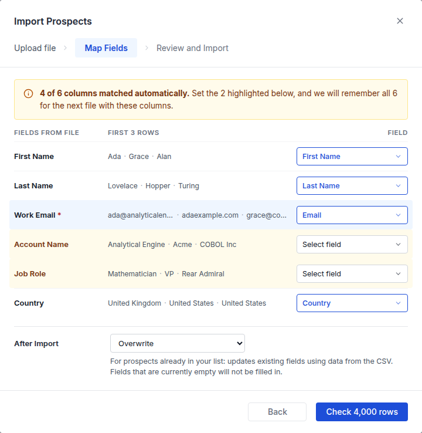</a> <b>After Import: Overwrite</b>. Production label and text, shown under the select</td></tr><tr><td valign="top" width="33%"><a href="canvas/shots/m10.png">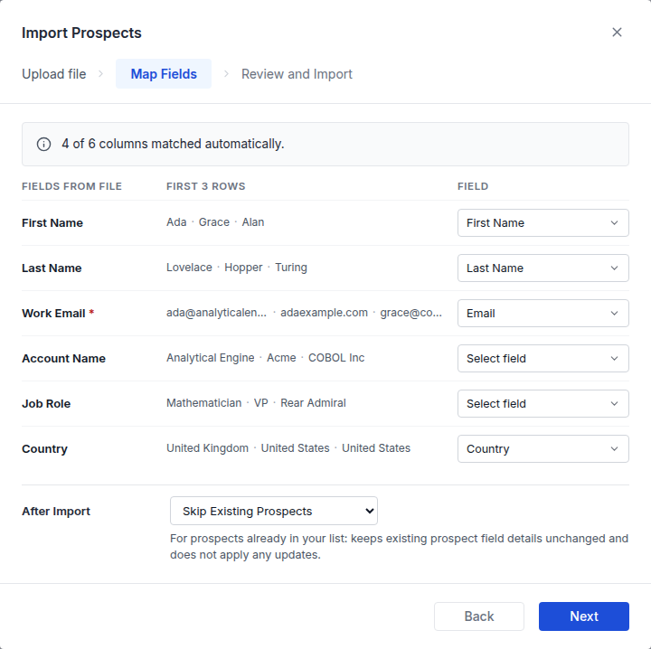</a> <b>After Import: Skip Existing Prospects</b>. Production label and text, shown under the select</td></tr></table>

**5.3 Checking.** Progress in rows; "Nothing has been imported yet"; one Cancel.

<table><tr><td valign="top" width="33%"><a href="canvas/shots/c01.png">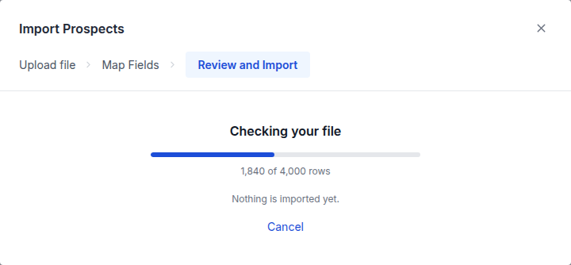</a> <b>Checking every row</b>. Nothing imported yet; one Cancel</td></tr></table>

**5.4 Review.** Every outcome is one row in one pattern: grey icon, number, sentence (Hitesh, 11 Nov). First row: new prospects to add, with the rows checked and file name under it. Then rows already in the list (worded by the After Import option, with Change), repeats, and anything that needs the user. Colour and a button appear only on rows that need the user: step-needs and plan limit in amber (nothing is wrong in the file), rows to fix in red. Clean file: one row, "Every row is ready." No boxes, no bar. Tags and Verification stay below a rule, as production. States: plan limit, plan full (only rows already in the list can be updated), credits short, another import running (known on arrival, Import disabled), "Importing…" while sending, Import failed and limit reached during import (dialog stays, "Import again", file and mapping kept), every row fails (Download is primary, Upload fixed file on the left; a dominant reason suggests checking the Email mapping). When the download holds more than the rows to fix, the fix row says what else is in it. The Import button names the new prospects ("Import 3,540 new prospects"); updates are stated on their own line. Verification says the 15-day skip; it is a fixed default, with no link to change it.

<table><tr><td valign="top" width="33%"><a href="canvas/shots/r01.png">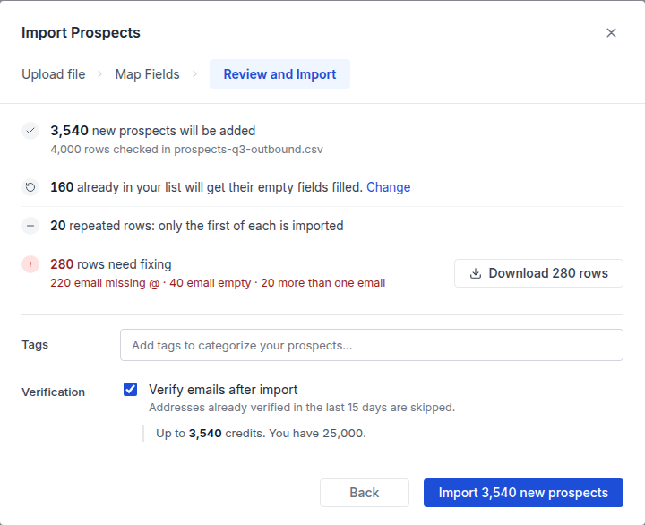</a> <b>Review</b>. One row per outcome; colour and a button only on rows that need you</td><td valign="top" width="33%"><a href="canvas/shots/r02.png">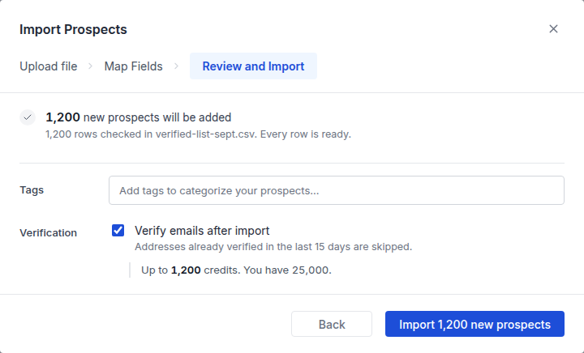</a> <b>Clean file</b>. One row: every row is ready</td><td valign="top" width="33%"><a href="canvas/shots/r03.png">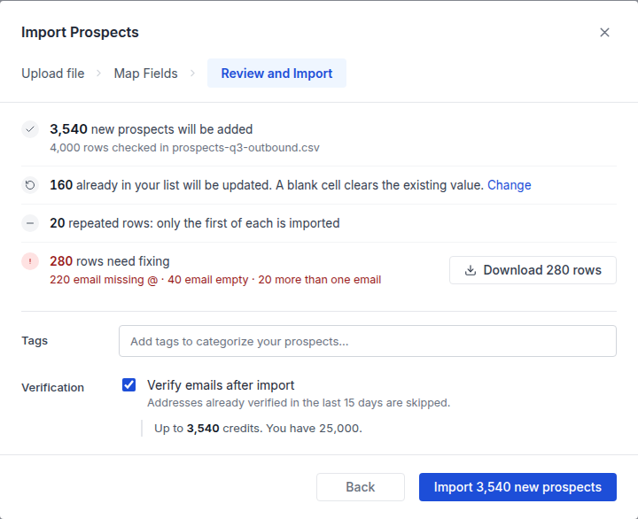</a> <b>Already in your list: Update All Fields</b>. The line says what this option does to them</td></tr><tr><td valign="top" width="33%"><a href="canvas/shots/r04.png">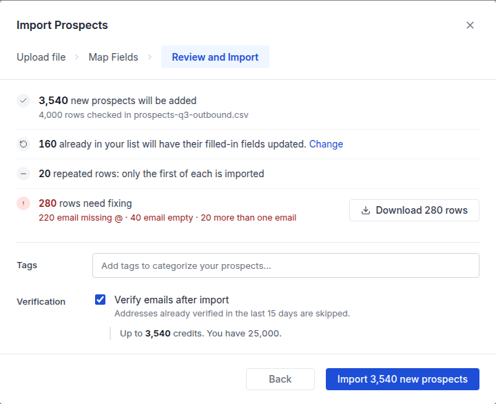</a> <b>Already in your list: Overwrite</b>. The line says what this option does to them</td><td valign="top" width="33%"><a href="canvas/shots/r05.png">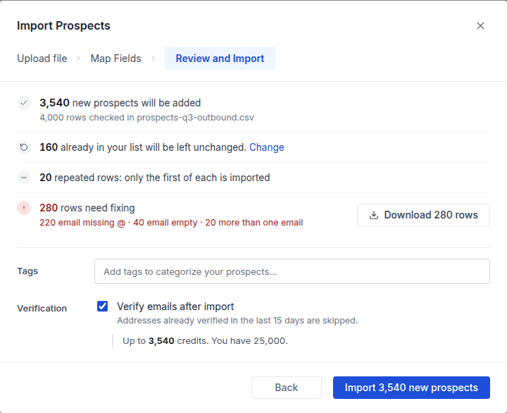</a> <b>Already in your list: Skip Existing Prospects</b>. The line says what this option does to them</td><td valign="top" width="33%"><a href="canvas/shots/r06.png">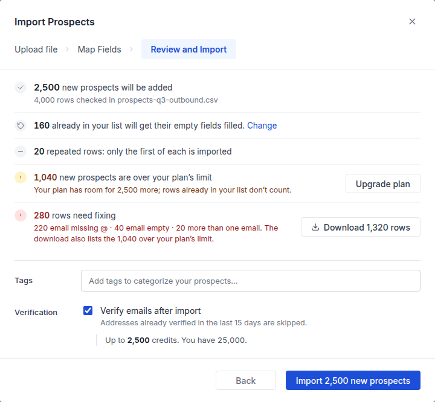</a> <b>Over the plan limit</b>. Amber: the account needs room; red stays for rows to fix</td></tr><tr><td valign="top" width="33%"><a href="canvas/shots/r07.png">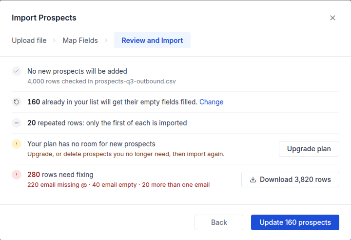</a> <b>Plan full</b>. Grey headline; only rows already in the list can be updated</td><td valign="top" width="33%"><a href="canvas/shots/r08.png">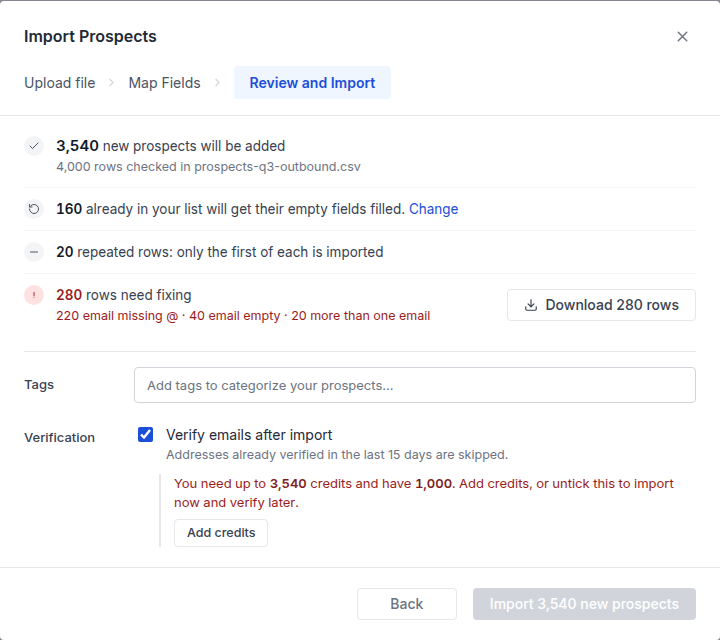</a> <b>Not enough credits</b>. Credits needed and held; Import disabled</td><td valign="top" width="33%"><a href="canvas/shots/r09.png">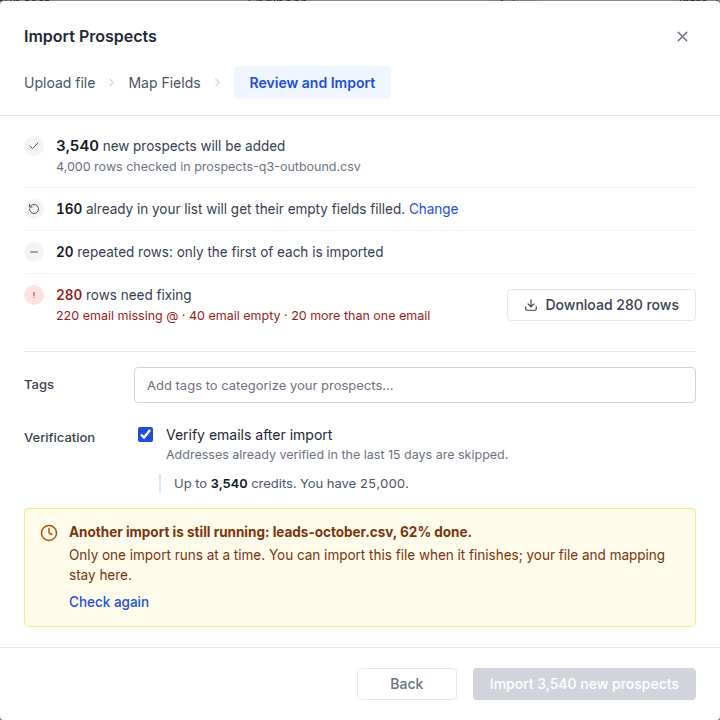</a> <b>Another import running</b>. Known on arrival; Import disabled</td></tr><tr><td valign="top" width="33%"><a href="canvas/shots/r10.png">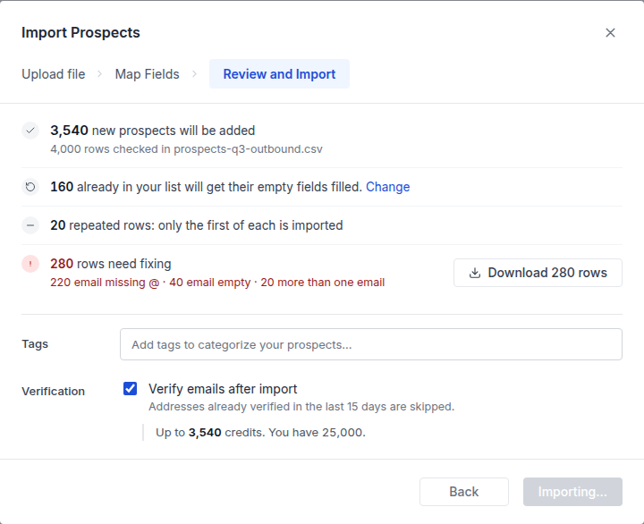</a> <b>Importing…</b>. The button while the file is sent</td><td valign="top" width="33%"><a href="canvas/shots/r11.png">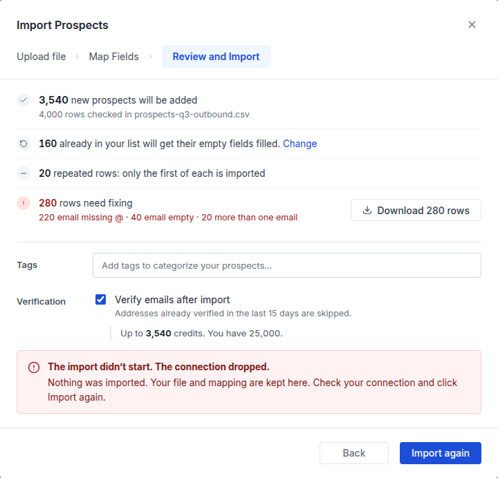</a> <b>Import failed</b>. Dialog stays; Import again</td><td valign="top" width="33%"><a href="canvas/shots/r12.png">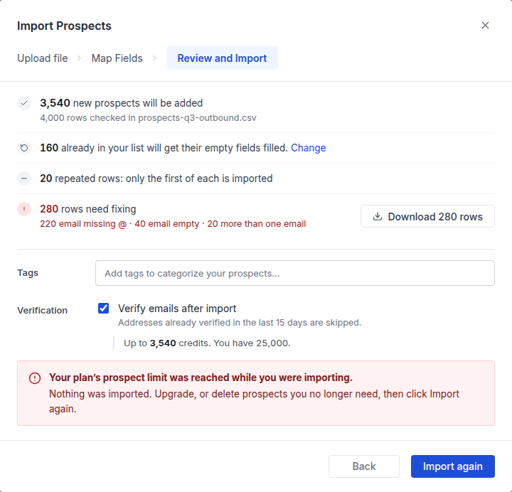</a> <b>Limit reached during import</b>. Nothing imported; file and mapping kept</td></tr><tr><td valign="top" width="33%"><a href="canvas/shots/r13.png">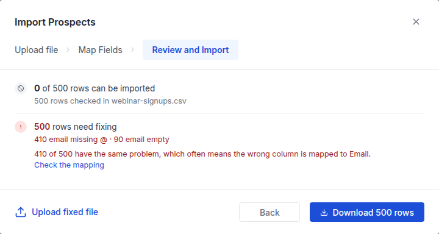</a> <b>Every row fails</b>. Download is primary; Upload fixed file; check the mapping</td><td valign="top" width="33%"><a href="canvas/shots/r14.png">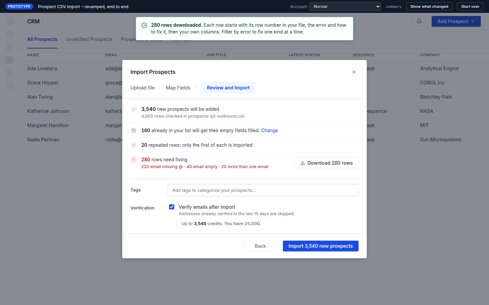</a> <b>Download toast</b>. What the file holds, right after Download</td></tr></table>

**5.5 After Import.** Production's progress card, closed when finished (today it then claims every row imported). Toast for what was added; strip on the list for what's left, with Download and Upload fixed rows; bell keeps both. Counts come from the import.

<table><tr><td valign="top" width="33%"><a href="canvas/shots/a01.png">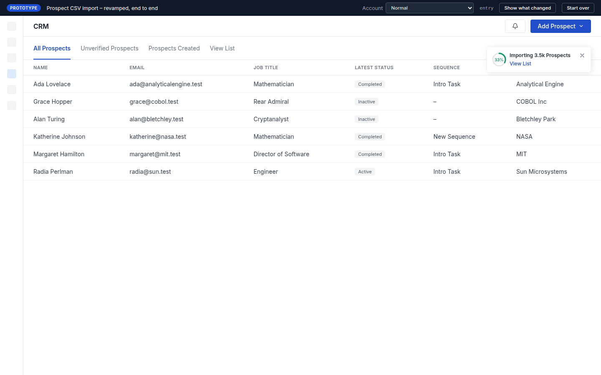</a> <b>Importing</b>. Production’s progress card, top right on every page</td><td valign="top" width="33%"><a href="canvas/shots/a02.png">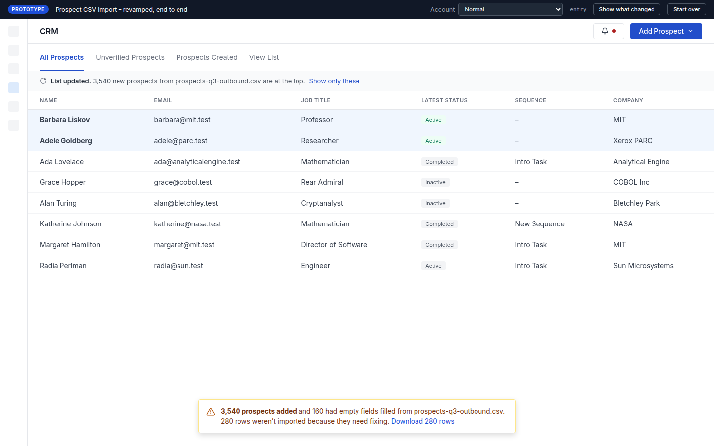</a> <b>Finished, rows to fix</b>. Toast for what was added; strip for what is left</td><td valign="top" width="33%"><a href="canvas/shots/a03.png">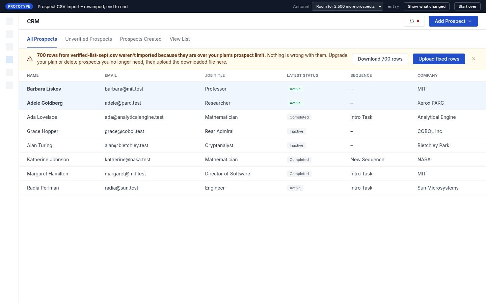</a> <b>Finished, over the limit only</b>. Nothing wrong with the rows; the plan needs room</td></tr><tr><td valign="top" width="33%"><a href="canvas/shots/a04.png">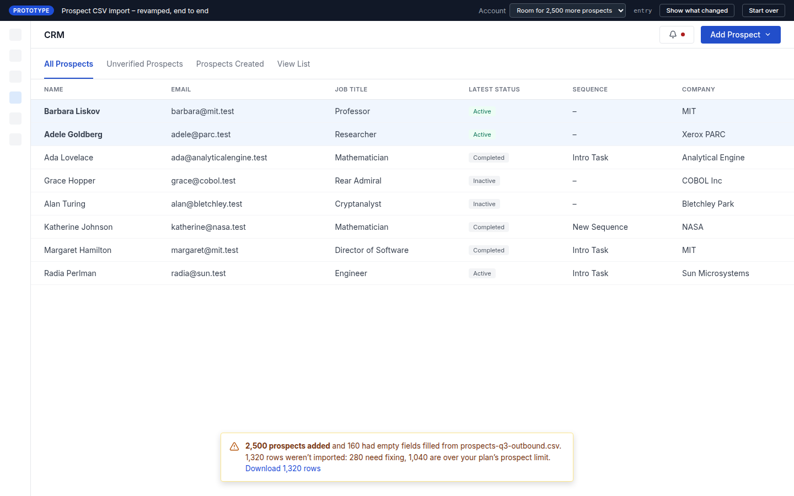</a> <b>Finished, both</b>. Rows to fix and rows over the limit in one strip</td><td valign="top" width="33%"><a href="canvas/shots/a05.png">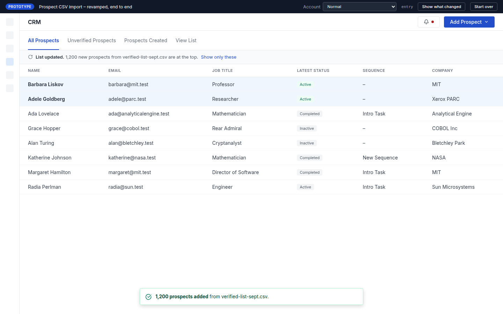</a> <b>Finished, nothing left</b>. Toast only; no strip</td><td valign="top" width="33%"><a href="canvas/shots/a06.png">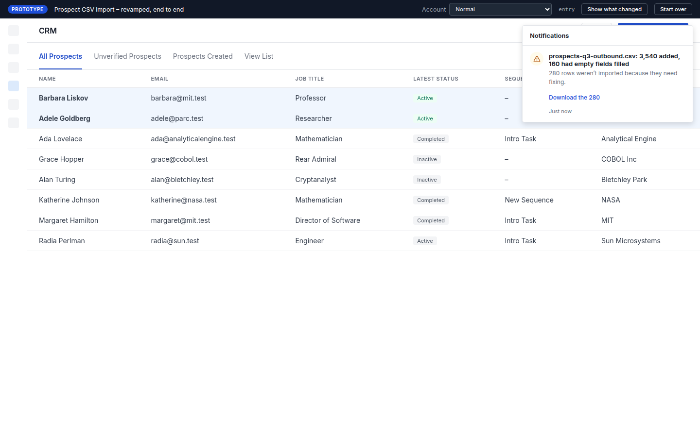</a> <b>Notifications</b>. The bell keeps the record</td></tr></table>

**5.6 Email.** Real counts and top three error names; never "Congratulations" when rows failed.

<table><tr><td valign="top" width="33%"><a href="canvas/shots/e01.png">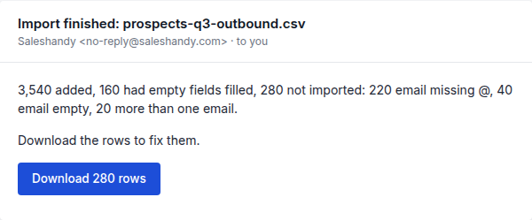</a> <b>Email: rows to fix</b>. Real counts and the top errors</td><td valign="top" width="33%"><a href="canvas/shots/e02.png">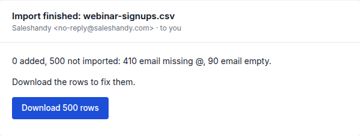</a> <b>Email: every row failed</b>. Never “Congratulations”</td><td valign="top" width="33%"><a href="canvas/shots/e03.png">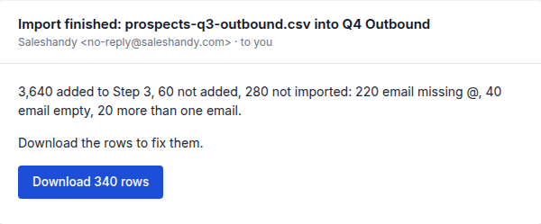</a> <b>Email: sequence import</b>. Names the sequence and the step</td></tr></table>

**5.7 The rows-to-fix file.**
- Columns: `row_number` (as a spreadsheet shows it, header is row 1), `error`, `how_to_fix`, then the user's columns untouched.
- One line per row not fully imported, blank-email rows included. Repeated rows and rows skipped under Skip Existing Prospects are counts on Review, not lines in the file.
- `error` is one of 19 fixed names, the same words on every surface. `how_to_fix` names the user's column and value.
- Second round: our three columns are replaced, never added again; original `row_number` kept; name never doubled.
- Quote any cell with `,` `"` `;` tab or line break (LibreOffice and European Excel split on `;`, reproduced 6 Nov). UTF-8 with BOM. `{name}-rows-to-fix.csv`.
- Delete the unused reasons `NoUpdate`, `NoOverwrite`, `ProspectInCallDNC`, `ContactInDncList`.

<table><tr><td valign="top" width="33%"><a href="canvas/shots/f01.png">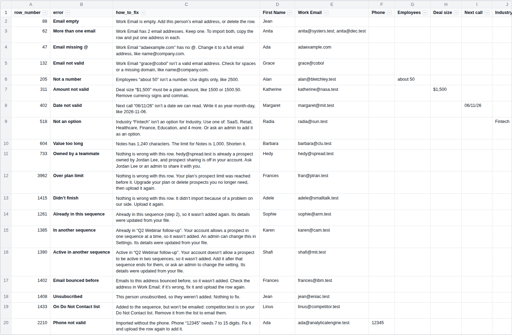</a> <b>The rows-to-fix file</b>. row_number, error, how_to_fix, then the user’s own columns</td><td valign="top" width="33%"><a href="canvas/shots/f02.png">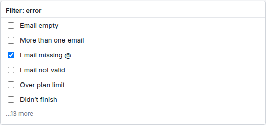</a> <b>Filtered by error</b>. Fix one kind at a time</td><td valign="top" width="33%"><a href="canvas/shots/f03.png">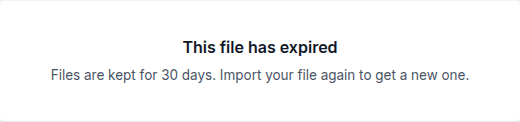</a> <b>Expired download link</b>. Plain page instead of raw JSON</td></tr></table>

**5.8 Import into a sequence.** Same dialog. Entry blocked if the sequence has no steps. Review starts with "Import into [Step · type]"; the headline counts prospects added to the step (new plus existing, as production). Lines for existing prospects added, and those turned away (another sequence per the admin setting, already in this sequence, bounced or unsubscribed). Map Fields warns when no column is mapped to a field the sequence's steps need (every step, not only the one picked). Review warns, in an amber row, only about rows with that field empty. Button "Add {n} to Step {k}".

<table><tr><td valign="top" width="33%"> <b>Sequence: no phone or LinkedIn column</b>. Warned while mapping, for every step; Next stays enabled</td><td valign="top" width="33%"> <b>Sequence: phone mapped, LinkedIn missing</b>. The warning names only what is still missing</td><td valign="top" width="33%"> <b>Into an email step</b>. Step picked on Review; who won’t be added and why</td></tr><tr><td valign="top" width="33%"> <b>Into a call step, some phones empty</b>. Phone mapped; the rows without one are counted</td><td valign="top" width="33%"> <b>Into a LinkedIn step, some URLs empty</b>. Same warning for LinkedIn profile URLs</td><td valign="top" width="33%"> <b>Sequence with no steps</b>. Blocked before the dialog opens</td></tr><tr><td valign="top" width="33%"> <b>After a sequence import</b>. Strip on the sequence’s Prospects tab</td><td valign="top" width="33%"> <b>Notifications after a sequence import</b>. Added to the step, and how many weren’t</td></tr></table>

**5.9 Bringing a file back.** Headers match a confirmed mapping, every column decided, Email mapped: Upload says "Mapping restored" and Next becomes "Check {rows} rows", skipping Map Fields.

<table><tr><td valign="top" width="33%"> <b>Fixed file brought back</b>. Mapping restored; Check 280 rows skips Map Fields</td><td valign="top" width="33%"> <b>Mapping restored</b>. Same columns as last time; our three columns set to Don’t import</td></tr></table>

### Acceptance criteria

| ID | Case | Expected | P |
|---|---|---|---|
| A1 | Upload each of the 11 rejected kinds in COPY.md §5.1 | Rejected in the drop zone with its §5.1 title and fix; no row total, header name or column letter appears; the zone accepts the next file; Next disabled; no toast | P0 |
| A2 | No column mapped to Email; a file with no email column | §5.2 message; Next disabled | P0 |
| A3 | 4,000 rows: 220 no @, 40 blank, 20 two emails, 160 existing, 20 repeated | Review: 3,540 new; 160 existing with the option's outcome; 20 repeated; red row "280 rows need fixing" with three reasons; button "Import 3,540 new prospects" | P0 |
| A4 | A3 under each After Import option | Review, toast and bell use that option's words; 3 of the 160 read back in the list match it | P0 |
| A5 | Download from A3 | 280 lines; header `row_number,error,how_to_fix,` + original headers; only the 19 names; blank-email rows present; row numbers match Excel | P0 |
| A6 | Open A5 in LibreOffice with tab, `;` and `,` separators | Every row has the same column count | P0 |
| A7 | Upload A5 back, import under a plan limit, download again | Mapping restored; one set of our columns; original row numbers; name not doubled | P0 |
| A8 | Room for 2,500; A3's file | Review: plan row amber with Upgrade plan, fix row red. Import: 2,500 added; 1,040 "Over plan limit" lines, new prospects only, numbers within the file | P1 |
| A9 | Import fails; another import running; plan limit reached between Review and Import | Dialog stays on Review with the matching message; file and mapping kept; busy known before Import; nothing imported | P0 |
| A10 | Every row fails | "0 of {rows}"; Download primary, Upload fixed file on the left; dominant-reason hint over 50% | P1 |
| A11 | Credits short | Credit message with numbers; Import disabled until unticked or topped up; no link to change the 15 days | P1 |
| A12 | Force a batch to fail mid-import | Its rows in the file as "Didn't finish"; strip, bell and email count them | P0, **sign off by name: Rajat** |
| A13 | Invalid phone on a new prospect | Imported, phone blank, "Phone not valid" line | P1 |
| A14 | Sequence import: other sequence, bounced, unsubscribed, DNC | Each in the file under errors 13 to 18 | P1 |
| A15 | Email for a partial and a fully failed import | Real counts; never "Congratulations" | P1 |
| A16 | Keyboard only through the wizard | §7 rules hold; failures and the strip are announced | P1 |
| A17 | 390px wide | Map rows stack; no sideways scroll; footer buttons full width, primary last; toast never covers the footer | P1 |
| A18 | Every footer at 1440px | Gray secondary left of primary, 16px apart; Back on Map and Review, Cancel on Upload | P2 |
| A19 | Map two columns to Email | Second pick moves it and says so | P1 |
| A20 | Sequence import with a call and a LinkedIn step, no phone or LinkedIn column | Map Fields warns naming both fields and steps; Next stays enabled; mapping a phone column drops the call step from the warning; Review shows no unmapped-field row | P1 |
| A21 | Sequence import, prospects in another sequence, admin setting off | Counted on Review before Import; "In another sequence" in the file; toast counts only those added | P0 |
| A22 | Upload the fixed file from A5 | "Mapping restored"; "Check {rows} rows" lands on Review without Map Fields | P1 |
| A23 | Upload a valid 6-column and an 18-column file | One file line, then the first 3 rows under the file's headers as read; long values truncate with the full value on hover; "scroll sideways" shows only when the table is wider than the dialog | P1 |

## 6. Reconciliation with existing behaviour

| Path | Today | After |
|---|---|---|
| CRM list › Import CSV (`/contacts/import-async`) | Two-column report | This PRD |
| Sequence › Import via CSV (`/contacts/sequence-async/:stepId`) | Same report, picker on Map Fields | This PRD, §5.8 |
| Public API import | 7 reasons have no status code; `status` comes back undefined ([gateway](https://github.com/saleshandy/saleshandy-open-api-gateway/blob/3561cf80b480bb48cf0670c22a9c7f977012a4fc/src/common/enums/prospect-import-failed-reason.ts#L1)) | Add the missing codes; copy out of scope |
| Lead Finder bulk add | Shares the import service | Must not change |

- **Overwrite** writes only fields the prospect already has; production's description says so and stays verbatim. No behaviour change.
- Repeats are caught only within a 1,000-row chunk ([L2534](https://github.com/saleshandy/saleshandy-background-jobs/blob/7d18274f935ac261db9fa538aa3afe3d72d6894c/src/contacts/services/contacts-import.service.ts#L2534)); the import must match the pre-import check over the whole file, or counts drift.

## 7. Cross-cutting

| Rule | |
|---|---|
| No green toast, success icon or "Congratulations" for an outcome with failures | Release blocker |
| No "Oops!", raw server text or JSON anywhere in the flow | Release blocker |
| One name per error, same words on every surface | Release blocker |
| Footer as production's import dialog: 20/24 padding, 16px gap, link left, gray secondary then primary right; full width below 720px | |
| Dialog semantics, Tab trapped, Esc closes a list then the dialog, focus kept on re-render, failures `role="alert"` | |
| Contrast at least 4.5:1; no functional text under 11px | |
| Upgrade plan and Add credits open Billing and the credits checkout. The 15-day verification window is a fixed default, with no link to change it | |
| Colour: red for rows to fix and failed imports; amber for needs attention when nothing in the file is wrong (plan limit, step needs); blue for the one action left | |
| No "Saleshandy" in any message (white-label) | |

At 390px:

<table><tr><td valign="top" width="33%"> <b>Rejected file</b>. Centred; drop line wraps as one</td><td valign="top" width="33%"> <b>Map Fields</b>. Rows stack; picker under each column name</td><td valign="top" width="33%"> <b>Review</b>. Box rows stack; footer buttons full width</td></tr><tr><td valign="top" width="33%"> <b>Sequence Review</b>. Step picker above the numbers</td><td valign="top" width="33%"> <b>Strip</b>. Buttons wrap below the message</td></tr></table>

## 8. Implementation notes

- **Pre-import check:** row checks plus existing-prospect and sequence-membership lookups over the whole file. **Resolve before estimation:** time on 100,000 rows.
- **Failed-row storage:** one entry per source row with its number and cells, replacing one per (reason, email) via `$addToSet` ([L6717](https://github.com/saleshandy/saleshandy-background-jobs/blob/7d18274f935ac261db9fa538aa3afe3d72d6894c/src/contacts/services/contacts-import.service.ts#L6717)). **Resolve before estimation:** size at 100,000 rows of 120 columns.
- **All problems per row:** the check chain stops at the first hit today ([L2534-L2563](https://github.com/saleshandy/saleshandy-background-jobs/blob/7d18274f935ac261db9fa538aa3afe3d72d6894c/src/contacts/services/contacts-import.service.ts#L2534-L2563)). If costly, ship the first problem only.
- **Busy check on Review** needs "is an import running for this user".
- **Upload checks move to the browser:** mixed separators and a leading empty line are read from the header line the browser already parses ([pre-select.tsx L61](https://github.com/saleshandy/saleshandy-webui/blob/f9425f234ef9f23a3d1fe9a1bfd7b326b61b1ae5/src/components/sequence/components/sequence-single-content/components/sequence-single-contacts/components/select-file/components/pre-select/pre-select.tsx#L61)); not UTF-8 reuses the existing `is-utf8-file` util. The server keeps its checks as a backstop.

## 9. Measurement

**Never log** emails, cell values or file names; counts and error names only. Events ship with the feature.

| Event | Fires when | Key properties |
|---|---|---|
| `csv_import_step_viewed` | Each step opens | `step`, `path` |
| `csv_import_file_rejected` | Upload rejects | `reason` |
| `csv_import_blocked` | Next or Import disabled with a message | `reason` |
| `csv_import_reviewed` | Review shown | `new`, `existing`, `to_fix`, `reasons`, `after_import` |
| `csv_import_failed` | Import press fails | `reason` |
| `csv_import_completed` | Job finishes | `total_rows`, `added`, `updated`, `not_imported`, `reasons`, `path` |
| `csv_import_report_downloaded` | Any download | `rows`, `from` |
| `csv_import_reuploaded` | A file with our columns comes back | `mapping_restored`, `round` |

- **Most important signal:** fix loop closed, imports with rows to fix followed by a re-upload within 7 days. Target set at day 14 (no baseline).
- **Guardrails:** Checking median over 30 s for files under 10,000 rows (target, Rajat to confirm): rethink the pre-import check before release. Any import whose `not_imported` exceeds its file's lines: stop and fix.

## Appendix

- [Prototype](https://product-team-sh.github.io/prd-prospect-csv-import/prototype/): the intro card picks list or sequence import; the Account menu switches failure states; "Other rejected files" on Upload holds the rest of §5.1.
- [Every screen](https://product-team-sh.github.io/prd-prospect-csv-import/canvas/): 64 states captured from the prototype. Earlier design: [8 Sep canvas](https://product-team-sh.github.io/prd-prospect-csv-import/canvas/8-sep/).
- [COPY.md](COPY.md): every string, the file rules and all 19 errors with their code sites.
- QA: 17 CSV fixtures (malformed emails, ragged rows, separators, encodings, duplicate headers, header-only, LinkedIn-only).
- Reviews: [7 Sep](https://app.basecamp.com/4378325/buckets/22269754/card_tables/cards/10153297291#__recording_10278488304), [8 Sep](https://app.basecamp.com/4378325/buckets/22269754/card_tables/cards/10153297291#__recording_10280390333).
